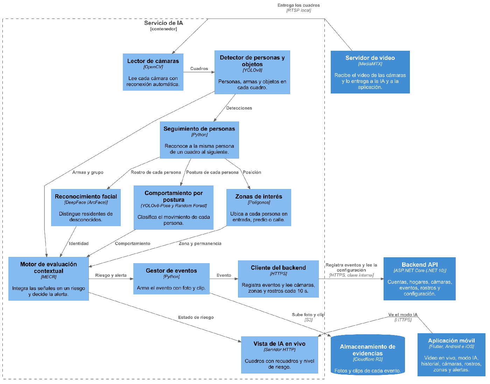
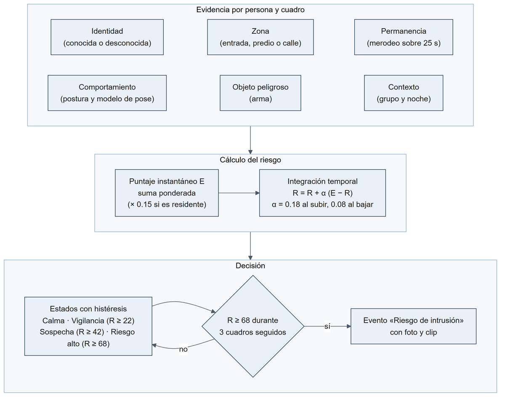
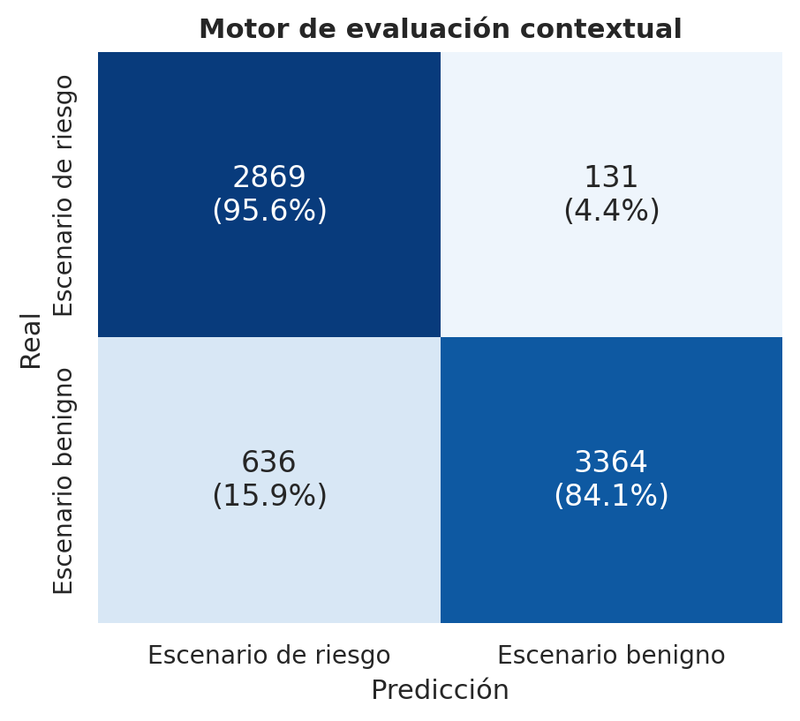
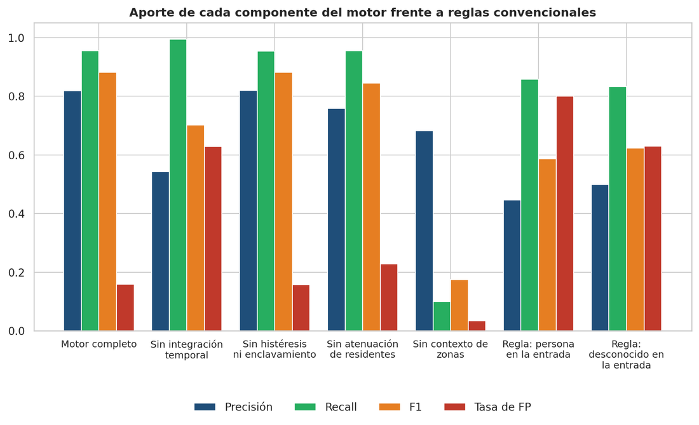

# VigiShield — servicio de IA

Analiza el video de las cámaras de cada hogar y decide cuándo una situación es un riesgo. Corre en la nube,
solo con CPU, junto al servidor de video (MediaMTX), y envía los eventos al
[backend](https://github.com/TP202610071/VigiShield-Main-Backend), que los guarda y avisa a la
[app](https://github.com/TP202610071/VigiShield-MobileApp).

Proyecto de tesis de Ingeniería de Software (UPC, 2026).

## Cómo funciona

<p align="center"></p>

Por cada cámara activa, un hilo lee el video de MediaMTX y, en cada cuadro analizado (~1.5 por segundo con
cuatro cámaras):

1. **YOLOv8** detecta personas y objetos peligrosos (cuchillo, bate, tijeras).
2. Un **seguimiento por IoU con predicción de velocidad** mantiene la identidad de cada persona entre cuadros
   y mide cuánto tiempo permanece.
3. **DeepFace con ArcFace** (detector YuNet) compara los rostros con los residentes registrados. Un rostro
   muy parecido se reconoce al instante; uno algo menos parecido necesita confirmarse en dos pasadas y ganarle
   con claridad al siguiente residente más parecido, para no poner el nombre equivocado.
4. **YOLOv8-Pose + Random Forest** (300 árboles, entrenado por el equipo) clasifica ventanas de 8 s del
   esqueleto de cada persona como movimiento normal o sospechoso.
5. Las **zonas** que el usuario dibuja en la app (puerta, reja, ventana, patio, calle) dan el contexto.
6. El **Motor de Evaluación Contextual de Riesgos (MECR)** combina todo y decide si alertar.

Cuando sale un evento, se guarda la mejor foto del momento y un clip anotado de unos 12 s en Cloudflare R2, y
se envía al backend.

### Eventos

| Evento | Cuándo |
|---|---|
| Acceso reconocido | Un residente registrado es reconocido |
| Persona desconocida | Una persona no es reconocida tras unos segundos |
| Merodeo | Una persona permanece más que el umbral (cada persona, una vez) |
| Riesgo de intrusión | El MECR confirma riesgo alto |
| Arma detectada | Un objeto peligroso junto a una persona |

### Motor de Evaluación Contextual de Riesgos

No es un modelo entrenado: es un algoritmo (`caiee.py`). Por cada persona suma un puntaje instantáneo con el
peso de las señales presentes, lo atenúa si es un residente reconocido (×0.15) y lo integra en el tiempo con
`R ← R + α(E − R)` (α = 0.18 al subir y 0.08 al bajar). R define cuatro estados con histéresis: calma,
vigilancia (≥ 22), sospecha (≥ 42) y riesgo alto (≥ 68); el evento sale si se sostiene tres cuadros.

<p align="center"></p>

| Señal | Peso |
|---|---|
| Persona desconocida | +22 |
| En zona de entrada / en el predio / en la calle | +24 / +14 / −12 |
| Merodeo (+12 si es en la entrada) | +22 |
| Arma cerca | +45 |
| Postura anómala | +15 |
| Grupo / noche | +10 / +9 |
| Modelo de pose | hasta +40 |

### Validación

7000 corridas simuladas de 14 escenarios domésticos, con el mismo código del motor y la cadencia real:
**recall 0.956, precisión 0.819, F1 0.882, MCC 0.789 y AUC 0.958**, con 80 % menos falsas alarmas que una
regla que alerta ante cualquier persona en la entrada.

<p align="center">
  
  
</p>

`tests/test_mejoras_2026_10.py` fija que el motor reciba la misma evidencia que se validó.

## Archivos principales

| Archivo | Qué hace |
|---|---|
| `main.py` | Arranca un hilo por cámara, sincroniza cámaras y rostros con el backend y envía eventos |
| `event_detector.py` | Detección, seguimiento, rostros, pose y armado de cada evento |
| `caiee.py` | Motor de evaluación contextual |
| `pose_behavior.py` | Pose + Random Forest |
| `zones.py` | Zonas de la cámara |
| `merodeo.py`, `identidad_rostro.py`, `confirmacion_rostro.py`, `rostros_evento.py` | Mejoras de 2026-10 (cada una con interruptor) |
| `frame_server.py` | Cuadros anotados y estado para la vista de IA de la app |
| `r2_client.py` | Subida de fotos y clips a R2 |

## Configuración (`.env`)

| Variable | Para qué |
|---|---|
| `BACKEND_API_URL`, `INTERNAL_API_KEY` | Backend y su clave interna |
| `R2_ENDPOINT`, `R2_ACCESS_KEY_ID`, `R2_SECRET_ACCESS_KEY`, `R2_BUCKET`, `R2_PUBLIC_BASE_URL` | Almacenamiento de evidencias |
| `YOLO_MODEL`, `FRAME_INTERVAL_SECONDS` | Modelo de detección y cadencia |
| `FACE_DISTANCE_THRESHOLD`, `FACE_DISTANCE_CONFIRMACION`, `FACE_MARGEN_MIN` | Reconocimiento facial |
| `LOITER_SECONDS`, `PERSON_MIN_HEIGHT_FRAC`, `PERSON_EVENT_CONFIDENCE` | Merodeo y filtro de personas lejanas |
| `MERODEO_POR_PERSONA`, `DESCONOCIDO_REQUIERE_ROSTRO`, `ROSTRO_EN_EVENTO`, `FACE_CONFIRMACION_ACTIVA` | Interruptores de las mejoras |

Las claves nunca van en el repositorio.

## Ejecutar

Producción usa Python 3.10 con PyTorch 2.12 (CPU), TensorFlow 2.21 + tf_keras 2.21, numpy 1.26.4,
deepface 0.0.100, ultralytics 8.4.58, opencv-python 4.8.0.76, Pillow 9.5.0, Flask 3.0.3 y boto3.

```bash
python -m venv venv && source venv/bin/activate   # Python 3.10
pip install torch==2.12.0 torchvision==0.27.0 --index-url https://download.pytorch.org/whl/cpu
pip install numpy==1.26.4 tensorflow==2.21.0 tf_keras==2.21.0 deepface==0.0.100 ultralytics==8.4.58 \
            opencv-python==4.8.0.76 Pillow==9.5.0 Flask==3.0.3 flask-cors python-dotenv requests boto3
python main.py
python -m pytest tests          # pruebas (no necesitan cámara ni modelos)
```

En producción corre como servicio `systemd` en una máquina virtual de Azure (4 vCPU, 16 GB), junto a MediaMTX
y nginx (HTTPS y autenticación del video con el JWT de la app).
